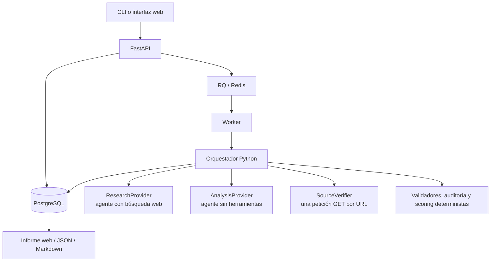

# Especificación técnica — Business Opportunity Research Engine (BORE)

**Documento de implementación para Devin Desktop**  
**Versión:** 1.1 (sustituye a la 1.0)  
**Fecha:** 13 de noviembre de 2026  
**Estado:** especificación funcional y técnica para construir un MVP ejecutable.

> **Instrucción principal para el agente desarrollador:** implementa el proyecto completo y ejecutable descrito a continuación. No te limites a proponer una arquitectura, generar pseudocódigo o preparar un README. Crea el código, las migraciones, los tests, los contenedores, la documentación y una demostración funcional. Si alguna integración externa necesita credenciales que no están disponibles, implementa y prueba el flujo íntegro con un proveedor simulado (*mock*) y deja la integración real lista para habilitarse con variables de entorno. No inventes investigaciones reales ni presentes datos simulados como verificados.

**Cómo leer este documento.** Los imperativos («implementar», «registrar», «no hacer») son requisitos obligatorios. «Recomendado» indica el valor por defecto: puede cambiarse solo con un motivo anotado en `docs/DECISIONS.md`. Los anexos A y B son informativos. Si dos apartados parecen contradecirse, prevalece el más restrictivo en materia de evidencias y seguridad, y la discrepancia se anota en `docs/DECISIONS.md`.

---

## 0. Entorno y reglas de trabajo del agente

1. **Equipo de desarrollo: Windows.** Todo debe arrancar con Docker Desktop (backend WSL 2) y `docker compose`. Ningún paso obligatorio puede depender de ejecutar el worker de forma nativa en Windows (véase 9.4).
2. **Contexto permanente.** Copia esta especificación en `docs/SPEC.md` y crea un `AGENTS.md` breve en la raíz (máximo 40 líneas) con las reglas que deben aplicarse en todas las sesiones: comandos de calidad de 13.4, prohibición de datos fabricados, prohibición de secretos en el repositorio y obligación de ejecutar los tests antes de dar algo por terminado. Devin Desktop carga `AGENTS.md` automáticamente como regla siempre activa.
3. **Registro de decisiones.** Toda desviación de esta especificación y toda ambigüedad resuelta se anota en `docs/DECISIONS.md` con fecha, decisión y motivo.
4. **Commits.** Un commit, como mínimo, por cada fase de la sección 12, con los tests de esa fase en verde.
5. **Gasto en APIs.** No ejecutes llamadas de pago durante el desarrollo salvo que existan a la vez `OPENAI_API_KEY` y `BORE_ALLOW_PAID_SMOKE=1`. En ese caso se permite una única ejecución de humo con `limits.max_usd <= 1.0`. Todo lo demás se prueba con proveedores simulados.
6. **Versiones.** No fijes versiones imaginadas de modelos ni de SDK. Resuelve versiones existentes y compatibles en el momento de implementar, fíjalas en `uv.lock` y anótalas en `docs/DEVELOPMENT.md`. Los nombres de modelos vienen siempre de variables de entorno.

---

## 1. Objetivo y alcance

Desarrollar una aplicación privada de investigación sistemática de oportunidades de negocio basadas en **software**, **SaaS**, **aplicaciones web** o **aplicaciones móviles**. El usuario introduce un sector —por ejemplo, «inmobiliario»— y el sistema:

1. Mapea subsectores, segmentos, actores y problemas de negocio.
2. Investiga demanda y señales externas mediante búsqueda web.
3. Genera entre 20 y 30 oportunidades candidatas y elimina las duplicadas.
4. Descarta las que incumplen los criterios obligatorios de negocio.
5. Sondea de forma superficial las elegibles y selecciona las más prometedoras para el análisis profundo.
6. Investiga competidores, alternativas, precios, debilidades y canales de adquisición de las seleccionadas.
7. Audita las evidencias: comprueba procedencia, accesibilidad y respaldo real de cada afirmación.
8. Evalúa cada oportunidad mediante una rúbrica reproducible, con evidencias y grado de confianza.
9. Somete las candidatas mejor puntuadas a una revisión crítica independiente y recalcula sus notas.
10. Entrega **hasta cinco oportunidades** ordenadas; si solo dos superan el umbral, entrega dos. Nunca rellenar con ideas deficientes.
11. Conserva resultados, fuentes, versiones, costes y trazas para permitir auditoría y futuras comparaciones.

**Mercado inicial:** España. **Idioma:** español de España. **Usuario inicial:** una persona, uso privado. **Unidad de evaluación:** una oportunidad de producto digital con un comprador identificable, problema concreto y mecanismo de monetización plausible.

### Resultado esperado por oportunidad

- Nombre provisional, descripción y segmento objetivo.
- Problema y evidencias que lo sustentan.
- Usuario, comprador y contexto de compra.
- Propuesta de valor y flujo de producto.
- Funcionalidades de MVP y funcionalidades excluidas.
- Competidores y sustitutos **reales**, con enlaces, posicionamiento, precios comprobados o «no verificados».
- Estrategias de adquisición y obstáculos comerciales.
- Modelo de negocio y supuestos de precio; estimaciones diferenciadas de datos observados.
- Comprobación de economía unitaria (5.3): clientes de pago necesarios para el objetivo de beneficio, marcada como hipótesis.
- Barreras técnicas, disponibilidad de datos, riesgos legales/operativos, posible sustitución por LLM generalistas.
- Estimación de alcance técnico y coste de mantenimiento, marcados como estimaciones.
- Notas individuales, nota ponderada, grado de confianza y explicación de las notas.
- Evidencias verificables con URL, fecha de consulta y relación entre afirmación y fuente.
- Objeciones del agente crítico y conclusión de «seguir investigando / validación comercial / descartar».

### Fuera del alcance del MVP

- Generar o desplegar el producto propuesto.
- Hacer publicidad, compras, contactos comerciales o entrevistas automáticamente.
- Acceder a bases de datos privadas sin autorización.
- Scraping masivo, elusión de captchas, pagos o autenticaciones de terceros.
- Garantizar demanda, rentabilidad o éxito comercial a partir de investigación web.
- Cobros y multiusuario SaaS en la primera versión.
- Orquestación autónoma abierta e ilimitada.
- Volúmenes de búsqueda de palabras clave (SEO/ASO) obtenidos de APIs especializadas. Queda como extensión prevista mediante un proveedor adicional; en el MVP, ningún agente puede afirmar un volumen de búsqueda sin una fuente citada.
- Deduplicación entre ejecuciones distintas y comparación histórica automática (el modelo de datos la permite, pero no se implementa).

---

## 2. Principios de diseño

1. **El código controla el workflow**: etapas explícitas, presupuestos y estados persistidos. Los LLM generan hipótesis y analizan evidencias, pero no determinan el flujo. No se usan *handoffs* entre agentes ni memoria de sesión del SDK: cada llamada recibe sus entradas de forma explícita.
2. **Evidencia antes que nota**: no hay afirmaciones de competencia, precios, demanda o regulación presentadas como hechos sin fuentes externas verificables. Las notas se proponen **después** de la auditoría y solo a partir de afirmaciones auditadas.
3. **Las URL nunca salen de la prosa del modelo**: las fuentes proceden únicamente de los metadatos estructurados del proveedor de búsqueda; el modelo solo puede referirse a ellas por identificador (4.2).
4. **Reproducibilidad**: registrar versiones de prompts, esquema, ponderaciones, tarifas, proveedor, modelo, fecha y configuración de cada ejecución.
5. **No duplicación**: desduplicación semántica de problemas, compradores y productos, además de deduplicación de URL.
6. **Falsabilidad**: incluir un análisis *red team* que trate de invalidar la oportunidad, no solo defenderla.
7. **Evaluadores ciegos al umbral**: ningún agente recibe el umbral de publicación, los pesos ni el número de ideas solicitado. Así no pueden ajustar las notas para «aprobar».
8. **Coste limitado**: cuotas por ejecución, límites de tokens/consultas/tiempo y parada cuando se excede el presupuesto.
9. **Arquitectura modular**: interfaces pequeñas para modelos, investigación web, verificación de fuentes y repositorios, sin capas especulativas.
10. **Calidad > cantidad**: `requested_ideas=5` es un máximo; la cantidad publicada puede ser cero.

---

## 3. Arquitectura propuesta

### 3.1 Stack

| Componente | Elección MVP | Motivo y notas |
|---|---|---|
| Lenguaje | Python 3.13 o 3.14 (mínimo 3.12) | Ecosistema de IA y tipado. Fijar una única versión menor en `.python-version` y en el `Dockerfile`. Python 3.15 se publicó el 9-oct-2026: no adoptarla hasta comprobar que todas las dependencias publican *wheels* |
| Backend | FastAPI + Pydantic v2 | Contratos claros y API sencilla |
| Agentes | `openai-agents` (OpenAI Agents SDK) | Herramientas hospedadas, salidas tipadas, uso y trazas |
| Búsqueda | `WebSearchTool` del Agents SDK, tras un adaptador propio | Investigación web integrada; solo funciona con modelos de OpenAI sobre la Responses API |
| Verificación de fuentes | `httpx` con un verificador propio de una sola petición por URL | Comprobar que la fuente existe y contiene lo citado (4.4). No es un *crawler* |
| Persistencia | PostgreSQL 17 o 18 | Histórico estructurado, JSONB y consultas fiables. Fijar la versión mayor de la imagen. PostgreSQL 19 tiene disponibilidad general prevista para el 19-nov-2026: no adoptarla en el MVP |
| ORM/migraciones | SQLAlchemy 2 (API asíncrona) + `psycopg` 3 + Alembic | Un solo driver para uso síncrono (migraciones) y asíncrono (aplicación) |
| Jobs | RQ + Redis | Ejecuciones largas sin bloquear HTTP; worker sencillo. Requisitos específicos en 9.4 |
| Interfaz MVP | FastAPI + Jinja2 + HTMX + CSS | UI privada sin segundo backend ni infraestructura Node |
| CLI | Typer | Cliente de la API y utilidades de demostración |
| Validaciones | Pydantic + validadores de negocio | Salidas y reglas verificables |
| Dominios | `tldextract` con la lista de sufijos incluida en el paquete, sin descarga en ejecución | Calcular el dominio registrable (eTLD+1) para la regla de dominios independientes |
| Testing | pytest + pytest-asyncio, `respx`, utilidades `agents.testing` del SDK | Unitarios e integración sin gastar API |
| Calidad | Ruff, mypy o pyright, pre-commit | Estándares mantenibles |
| Despliegue | Docker Compose | `api`, `worker`, `postgres`, `redis` y una tarea `migrate` de un solo uso |

**Compose.** Declarar *healthchecks* y `depends_on` con `condition: service_healthy`; ejecutar las migraciones antes de arrancar `api` y `worker`; publicar únicamente el puerto de la API y solo en *loopback* (`127.0.0.1:8000:8000`); no publicar los puertos de PostgreSQL ni de Redis en el host.

### 3.2 Esquema lógico



En toda ejecución, la **base de datos es la fuente de verdad** del estado de negocio. Redis solo transporta trabajos y metadatos transitorios. No usar tareas largas con `FastAPI BackgroundTasks` ni ejecutar la investigación completa dentro de una petición HTTP.

### 3.3 Proveedores

Definir tres contratos pequeños. El dominio y el orquestador dependen solo de ellos, nunca del SDK.

```python
from dataclasses import dataclass
from typing import Generic, Literal, Protocol, TypeVar

from pydantic import BaseModel

T = TypeVar("T", bound=BaseModel)


@dataclass(frozen=True)
class ProviderSource:
    ref: str  # "S1", "S2"… lo asigna el adaptador, no el modelo
    url: str
    title: str | None
    origin: Literal["annotation", "source_list", "synthetic"]


@dataclass(frozen=True)
class ResearchResult:
    text: str  # prosa del modelo: dato no confiable
    sources: tuple[ProviderSource, ...]  # única procedencia admitida de URL
    queries: tuple[str, ...]  # consultas ejecutadas, si el proveedor las expone
    usage: "UsageRecord"


@dataclass(frozen=True)
class AnalysisResult(Generic[T]):
    output: T
    usage: "UsageRecord"


class ResearchProvider(Protocol):
    async def research(self, task: "ResearchTask") -> ResearchResult: ...


class AnalysisProvider(Protocol):
    async def analyze(self, task: "AnalysisTask[T]") -> AnalysisResult[T]: ...


class SourceVerifier(Protocol):
    async def verify(self, url: str) -> "SourceCheck": ...
```

`UsageRecord` contiene, como mínimo: proveedor, modelo, peticiones, tokens de entrada, tokens de entrada en caché, tokens de salida, tokens de razonamiento, número de búsquedas web y duración.

Implementaciones del MVP: `OpenAIResearchProvider`, `OpenAIAnalysisProvider`, `HttpSourceVerifier` y sus equivalentes simulados (`FakeResearchProvider`, `FakeAnalysisProvider`, `FakeSourceVerifier`), deterministas y sin red.

Mantener el contrato desacoplado del proveedor, pero **no implementar Claude por defecto** en el MVP. Incorporarlo después como proveedor de auditoría independiente. No asumir que una herramienta de búsqueda web hospedada por OpenAI es directamente reutilizable por Anthropic.

### 3.4 Integración con el OpenAI Agents SDK

Hechos comprobados en la documentación oficial el 13-nov-2026 (anexo B). Reverifícalos contra la versión exacta que instales antes de escribir el adaptador:

1. **Búsqueda hospedada.** `WebSearchTool` admite `user_location`, `search_context_size` y `filters`. Configurar `user_location` con país `ES`. Empezar con `search_context_size="medium"` y hacerlo configurable: influye directamente en el coste.
2. **Lista de fuentes.** Pedir las fuentes consultadas con `ModelSettings(response_include=["web_search_call.action.sources"])`. El adaptador construye `ResearchResult.sources` uniendo esa lista con las anotaciones `url_citation` del texto, que son las que aportan título. La lista de fuentes puede no incluir títulos.
3. **Salida tipada y citas.** Hay informes de usuarios de que las anotaciones desaparecen cuando se combinan búsqueda web y salida estructurada en la misma petición. Por eso el diseño separa investigar y estructurar (4.2). Si un test externo demuestra que la versión instalada conserva las anotaciones con `output_type`, puede fusionarse en una sola llamada y anotarse en `docs/DECISIONS.md`.
4. **Uso.** Leer `result.context_wrapper.usage` (peticiones, tokens de entrada y salida, detalle de caché y razonamiento, y `request_usage_entries` por petición). Las búsquedas se cuentan recorriendo los elementos `web_search_call` de las respuestas, no las llamadas al agente.
5. **Límite de búsquedas por petición.** La Responses API tiene el parámetro `max_tool_calls`. Usarlo como límite blando si la versión instalada del SDK permite pasarlo; hay informes de que no siempre se respeta, así que el límite real es el recuento posterior y el corte entre llamadas (9.2).
6. **Trazas.** El SDK las tiene activadas por defecto y las exporta a OpenAI. En BORE quedan **desactivadas por defecto** (`OPENAI_AGENTS_DISABLE_TRACING=1`) y se activan con `BORE_TRACING_ENABLED=1`; al activarlas, `trace_include_sensitive_data` se controla con otra variable. No están disponibles para organizaciones con *Zero Data Retention*.
7. **Tests sin red.** Desde la versión 0.21 el SDK incluye `agents.testing` (`ScriptedModel` y auxiliares) para probar el bucle de ejecución sin peticiones al proveedor. Usarlo en los tests del adaptador; los proveedores simulados propios cubren el pipeline completo.
8. **Límites de ejecución.** Fijar `max_turns` en cada ejecución de agente y traducir las excepciones del SDK (comportamiento inválido del modelo, turnos agotados, errores de API) a los códigos de error de 9.1.

Variables de modelo: `BORE_MODEL_RESEARCH`, `BORE_MODEL_ANALYSIS` y `BORE_MODEL_REVIEW`. Se recomienda que el modelo de revisión sea distinto del de análisis. Comprobar en el arranque que el modelo de investigación admite la herramienta de búsqueda web y fallar con un mensaje claro si no es así.

---

## 4. Flujo de investigación

Implementar etapas con identificadores inmutables y persistir sus resultados. Cada una podrá reintentarse de forma idempotente.

| # | Identificador | Quién actúa | Web | Entrada | Salida |
|---|---|---|---|---|---|
| 1 | `sector_mapping` | SectorMapper | Sí | Sector y mercado | Subsectores, actores, procesos, problemas, universo de compradores y términos de búsqueda |
| 2 | `demand_research` | DemandResearcher | Sí | Problemas y segmentos | Afirmaciones de demanda y vacíos de información |
| 3 | `candidate_generation` | IdeaGenerator + deduplicación (4.5) | No | Mapa + afirmaciones | 20–30 candidatas diversas, sin duplicados |
| 4 | `eligibility_filter` | EligibilityAssessor propone; el código decide (5.2) | No | Candidatas + reglas | Elegibles, rechazadas y pendientes de revisión manual, con motivo |
| 5 | `shallow_screening` | DemandResearcher en modo sondeo | Sí | Elegibles | Señales preliminares y lista corta de `deep_dive_limit` candidatas |
| 6 | `market_validation` | CompetitionResearcher, GoToMarketAnalyst, TechnicalFeasibilityAnalyst | Sí | Lista corta | Competidores, sustitutos, precios, canales, alcance técnico y afirmaciones |
| 7 | `evidence_audit` | SourceVerifier (código) + EvidenceJudge | Solo el verificador | Afirmaciones + fuentes | Estado de cada fuente y de cada afirmación (4.4) |
| 8 | `scoring` | CriterionAssessor + función pura | No | Afirmaciones auditadas | Notas `initial`, confianza y nota ponderada |
| 9 | `adversarial_review` | CriticalReviewer + reauditoría + CriterionAssessor | Sí | Hasta `review_limit` candidatas con mejor nota inicial | Objeciones, contraevidencia y notas `final` |
| 10 | `ranking_and_report` | Código | No | Candidatas con nota final | Hasta `requested_ideas` resultados y exportaciones |

**Sondeo (etapa 5).** Máximo dos búsquedas por candidata elegible. El agente propone, con los mismos anclajes de 6.1, notas preliminares de `demand`, `distribution` y `competition`. El código calcula `screening_score` como media ponderada con los pesos de la rúbrica renormalizados sobre esos tres criterios y selecciona las `deep_dive_limit` mejores; los empates se resuelven por número de fuentes del proveedor. El `screening_score` es interno: nunca se publica ni se mezcla con la nota final. Las candidatas que no entran quedan como `not_shortlisted`, no como rechazadas.

**Revisión (etapa 9).** El revisor investiga contraevidencia; sus afirmaciones pasan por la misma auditoría de 4.4; después CriterionAssessor se ejecuta **una sola vez más** con todas las afirmaciones auditadas y produce las notas `final`. Solo pueden publicarse candidatas revisadas, por lo que la configuración exige `review_limit >= requested_ideas`.

**Evidencia insuficiente.** Si una búsqueda falla o no hay evidencia, no inferir resultados positivos de la ausencia de datos. Se permite como máximo una ampliación de búsquedas por oportunidad, con cargo a la reserva del presupuesto (9.2).

### 4.1 Agentes especializados

Implementar funciones de construcción de agentes separadas, con prompts versionados en ficheros y esquemas de salida de Pydantic. Reutilizar la definición de un agente entre ejecuciones no significa compartir memoria de otras investigaciones.

- **SectorMapper**: taxonomía, procesos, segmentos, fricciones recurrentes y consultas de búsqueda. Estima el universo de compradores potenciales solo con fuente citada (por ejemplo, recuentos de empresas por actividad en estadísticas oficiales). No propone productos como hechos existentes.
- **DemandResearcher**: busca señales de demanda: quejas, reseñas, foros, informes, estadísticas, procesos ineficientes. Distingue señal cualitativa de tamaño de mercado.
- **IdeaGenerator**: convierte problemas investigados en productos diferenciados, con comprador, valor y modelo de ingresos. Debe producir diversidad, no veinte variaciones de un CRM: máximo `max_candidates_per_subsector` por subsector.
- **EligibilityAssessor**: para cada candidata y cada regla de 5.2 responde `yes`, `no` o `uncertain` con un motivo. No decide el estado.
- **CompetitionResearcher**: detecta competidores directos, indirectos y sustitutos (incluidos hojas de cálculo, procesos manuales y herramientas genéricas); localiza páginas de producto y de precios, y no concluye «sin competencia» por una búsqueda fallida.
- **GoToMarketAnalyst**: canales de captación, intención de búsqueda, dificultad comercial, ciclo de compra, distribución y dependencias de terceros.
- **TechnicalFeasibilityAnalyst**: alcance de MVP, integraciones, acceso a datos, carga operativa, seguridad y dependencia de LLM generalistas.
- **EvidenceJudge** (sin herramientas): dado una afirmación y un fragmento de la página citada, responde `supports`, `contradicts`, `mentions` o `not_found`.
- **CriterionAssessor** (sin herramientas): recibe únicamente las afirmaciones auditadas de una oportunidad y propone, por criterio, una nota entera o `null`, una justificación y los identificadores de las afirmaciones que la sustentan.
- **CriticalReviewer**: busca contraejemplos, competidores omitidos, supuestos monetarios injustificados y motivos de fracaso. Su crítica se incorpora a los datos auditables.

El **scoring final no es un agente**: es una función Python pura y probada. Los agentes proponen valores por criterio y sus justificaciones; el código valida evidencias, aplica las reglas de 6.3 y calcula la media ponderada.

**Requisitos comunes de los prompts.** Cada prompt tiene un identificador de versión; declara el papel, las entradas y el esquema de salida; delimita el contenido procedente de la web como dato no confiable; ordena responder «no encontrado» en lugar de suponer; exige redactar en español de España; y nunca incluye el umbral de publicación, los pesos ni `requested_ideas`. Las consultas de búsqueda se hacen en español y, para competidores internacionales, también en inglés.

### 4.2 Patrón «investigar y después estructurar»

Toda tarea con búsqueda web se ejecuta en dos llamadas:

1. **Investigar** (`ResearchProvider`): agente con `WebSearchTool` y salida de texto libre. El adaptador recoge del proveedor las anotaciones `url_citation` y la lista de fuentes, las deduplica por URL canónica y les asigna referencias `S1…Sn`.
2. **Estructurar** (`AnalysisProvider`): agente **sin herramientas** y con salida tipada. Recibe el texto de la investigación y la lista numerada de fuentes. Produce afirmaciones con este contrato:

```python
class ExtractedClaim(BaseModel):
    text: str
    kind: Literal["fact", "estimate", "hypothesis"]
    criterion: (
        Literal[
            "demand",
            "distribution",
            "competition",
            "monetization",
            "technical",
            "ai_defensibility",
            "operational_legal",
        ]
        | None
    )
    source_refs: list[str]  # solo referencias de la lista recibida
    evidence_quote: str | None  # cita literal de la fuente, máximo 300 caracteres
```

Validación en código, no negociable:

- Una referencia que no exista en la lista se descarta y se registra un evento `unknown_source_ref`.
- Una afirmación `fact` sin referencias válidas se degrada a `hypothesis`.
- Ninguna URL que aparezca solo en la prosa del modelo se persiste como fuente.
- Los precios se extraen con importe, moneda, unidad y país; si falta alguno, `price_status` no puede ser `verified`.

### 4.3 Política de investigación externa

- Preferir fuentes primarias: webs de competidores, listados oficiales, datos públicos, documentación técnica, organismos y reguladores. Para España son puntos de partida orientativos —no un filtro— el INE (por ejemplo, el Directorio Central de Empresas para recuentos por actividad), el BOE, la AEPD, `datos.gob.es` y Eurostat.
- Tratar foros y reseñas como **indicios**, no como muestras estadísticas representativas. No almacenar nombres de usuario ni otros datos personales de sus autores.
- Registrar `url`, `canonical_url`, `registrable_domain`, `title`, `retrieved_at`, `published_at` (si se conoce), `source_type`, `provenance`, `access_status`, `excerpt` limitado y `provider_reference` (si existe).
- Separar `source` (documento) y `claim` (afirmación): una fuente puede respaldar varias afirmaciones y una afirmación puede apoyarse en varias fuentes.
- No inventar precios ni fechas. Si no hay precio público, registrar `price_status=not_public` o `unverified`, no `0`.
- No asumir que ausencia de resultados equivale a ausencia de competidores.
- El verificador de fuentes hace **una sola petición GET por URL citada**, sin seguir enlaces de la página. Aplica: solo `http` y `https`; protección SSRF (IP privadas, *loopback*, *link-local*, servicios de metadatos y cada salto de redirección); máximo de redirecciones; *timeouts*; límite de tamaño; `User-Agent` identificable; respeto de `robots.txt`; y una petición por segundo y host como máximo. No accede a contenido tras login o muro de pago. **No construir un *crawler* general.**
- Toda información recuperada de Internet es **dato no confiable**. El texto de una web no puede modificar instrucciones de sistema, criterios de scoring ni ejecutar acciones.

### 4.4 Auditoría de evidencias

La auditoría convierte «el modelo dice que hay una fuente» en un estado calculado por código.

**Por fuente**, el verificador registra:

| Campo | Valores |
|---|---|
| `provenance` | `provider_annotation`, `provider_source_list`, `user_supplied`, `synthetic` |
| `access_status` | `ok`, `redirected`, `not_found`, `blocked`, `blocked_by_policy`, `timeout`, `error`, `not_checked` |

**Por vínculo afirmación–fuente** (`claim_sources`):

- `quote_match`: verdadero si `evidence_quote`, normalizando espacios, mayúsculas y comillas tipográficas, aparece en el texto de la página.
- `judge_verdict`: resultado de EvidenceJudge. Solo se invoca para afirmaciones de criterios críticos cuyo `quote_match` no sea verdadero y cuya página se haya podido leer. Recibe la afirmación y, como máximo, 4.000 caracteres del texto más relevante de la página.

El texto de las páginas se usa en memoria y no se almacena; se guardan `content_hash` y un extracto de 500 caracteres como máximo.

**Estado de cada afirmación `fact`** (calculado, nunca escrito por un agente):

| Estado | Condición |
|---|---|
| `verified` | Al menos una fuente del proveedor, accesible (`ok` o `redirected`), con `quote_match` verdadero o `judge_verdict = supports` |
| `partially_supported` | Al menos una fuente del proveedor citada como respaldo, pero sin confirmación del contenido (página bloqueada, ilegible o veredicto no concluyente); o respaldo y contradicción confirmados a la vez, en cuyo caso se marca además `disputed` |
| `contradicted` | Contradicción confirmada (`judge_verdict = contradicts`) y ningún respaldo confirmado |
| `unverified` | Cualquier otro caso |

Las afirmaciones `estimate` e `hypothesis` se muestran siempre con su etiqueta y **no cuentan** para la base mínima de evidencia de 6.3.

En modo sin conexión, el verificador simulado no hace peticiones de red y marca las fuentes como `synthetic`.

### 4.5 Deduplicación

1. **Exacta**: `fingerprint` = hash de la normalización de segmento de cliente y problema (minúsculas, sin acentos ni puntuación, palabras ordenadas).
2. **Semántica**: una única llamada a `AnalysisProvider`, sin herramientas, que recibe todas las candidatas (identificador, segmento, comprador, problema, solución) y devuelve grupos de equivalentes. El código conserva la más completa de cada grupo y marca el resto como `duplicate` con `duplicate_of_id`.
3. No se usan *embeddings* ni extensiones vectoriales en el MVP: con 20–30 candidatas no compensan la dependencia añadida.
4. Las URL se deduplican por `canonical_url` (esquema y host en minúsculas, sin fragmento, sin parámetros de seguimiento `utm_*` y similares).

---

## 5. Configuración de la investigación y filtros

### 5.1 Parámetros

```json
{
  "sector": "inmobiliario",
  "country": "ES",
  "language": "es-ES",
  "requested_ideas": 5,
  "candidate_pool_size": 25,
  "max_candidates_per_subsector": 5,
  "deep_dive_limit": 8,
  "review_limit": 6,
  "min_final_score": 7.0,
  "min_critical_criterion_score": 6,
  "min_any_criterion_score": 4,
  "max_mvp_weeks": 6,
  "max_initial_budget_eur": 500,
  "min_target_operating_profit_eur_month": 500,
  "preferred_acquisition": ["seo", "aso", "communities", "referrals"],
  "limits": {
    "max_usd": 10.0,
    "max_web_search_calls": 180,
    "max_model_calls": 200,
    "max_duration_seconds": 5400,
    "max_retries_per_stage": 2
  }
}
```

Los valores son **configuración inicial editable**, no garantías de rentabilidad. Campos opcionales: descripción del cliente, problemas excluidos, competidores conocidos y términos bloqueados.

Validaciones: `candidate_pool_size` entre 20 y 30; `deep_dive_limit` entre 3 y 12; `requested_ideas` entre 1 y 10; `review_limit >= requested_ideas` y `review_limit <= deep_dive_limit`; `min_final_score` entre 1 y 10; longitudes máximas en todos los textos libres.

**Sobre los valores por defecto de coste y umbral** (estimaciones del autor de esta versión, a recalibrar con datos reales):

- Con las tarifas de lista de noviembre de 2026 —10 USD por cada 1.000 búsquedas web, más el contenido recuperado facturado como tokens de entrada del modelo— una ejecución completa con unas 180 búsquedas se sitúa aproximadamente entre 3 y 12 USD según el modelo elegido. El presupuesto de 5 USD de la versión 1.0 habría terminado con frecuencia en `partial`.
- Con los anclajes de 6.1, una oportunidad realmente buena (por ejemplo 8-7-7-7-9-7-9) obtiene 7,55. Un umbral de 8,0 exige de hecho un 8 de media en todos los criterios y tendería a publicar cero resultados o a presionar las notas al alza. Por eso el valor por defecto pasa a 7,0 con mínimos por criterio. Subirlo a 8,0 es legítimo una vez calibrada la rúbrica (6.5).

### 5.2 Reglas eliminatorias iniciales

| Código | Regla |
|---|---|
| `not_software` | El resultado no es un producto digital centrado en software |
| `data_access` | Requiere acceso a datos sin una vía legal y práctica razonable |
| `sales_dependency` | Depende esencialmente de acuerdos comerciales previos, fuerza de ventas o intervención manual constante, en contra de las preferencias configuradas |
| `llm_wrapper` | Se resuelve sustancialmente mediante un prompt genérico de un LLM, sin flujo propio, integraciones, datos o una ventaja defendible |
| `over_scope` | Excede claramente los límites de MVP y presupuesto |
| `redundant` | Es una variación redundante de una candidata ya admitida |

Decisión, en código, a partir de las respuestas de EligibilityAssessor:

- Algún `yes` → `rejected`, con el código de la regla y el motivo.
- `uncertain` en `data_access` → `needs_manual_review`: no avanza, para no gastar presupuesto en ideas de legalidad dudosa, y se lista aparte.
- `uncertain` en cualquier otra regla → continúa como `eligible` con la incertidumbre registrada y visible en el informe.
- `over_scope` solo puede ser `yes` **con evidencia suficiente**. Cuando el coste o el plazo no puedan estimarse con rigor, la respuesta correcta es `uncertain`.

El objetivo de beneficio mensual es un **criterio comercial a validar**, no un filtro eliminatorio que se pueda afirmar automáticamente desde la investigación web.

### 5.3 Comprobación de economía unitaria

Para cada oportunidad de la lista corta, el código calcula —a partir de las hipótesis de precio y costes— cuántos clientes de pago harían falta para alcanzar el objetivo:

```python
import math
from decimal import Decimal


def required_paying_customers(
    target_profit_eur_month: Decimal,
    price_eur_month: Decimal,
    variable_cost_eur_month: Decimal,
    fixed_cost_eur_month: Decimal,
) -> int | None:
    margin = price_eur_month - variable_cost_eur_month
    if margin <= 0:
        return None
    return math.ceil((target_profit_eur_month + fixed_cost_eur_month) / margin)
```

Si el universo de compradores tiene una afirmación `verified`, se calcula además el porcentaje de penetración necesario. Ambos datos se muestran como **hipótesis de trabajo**, nunca como ingresos demostrados ni como criterio eliminatorio. Registrar las hipótesis de usuarios de pago, precios, costes variables y coste de adquisición.

---

## 6. Modelo de evaluación

### 6.1 Criterios y pesos

| Código | Criterio | Peso | Crítico |
|---|---|---:|:---:|
| `demand` | Demanda real y relevancia del problema | 25 % | Sí |
| `distribution` | Facilidad de comercialización y adquisición | 20 % | Sí |
| `competition` | Diferenciación y presión competitiva | 15 % | Sí |
| `monetization` | Potencial de monetización | 15 % | Sí |
| `technical` | Viabilidad técnica del MVP | 10 % | No |
| `ai_defensibility` | Resistencia a sustitución por LLM generalistas | 10 % | No |
| `operational_legal` | Riesgo legal y operativo (10 = riesgo bajo) | 5 % | No |
| **Total** | | **100 %** | |

Cada criterio usa una puntuación **entera entre 1 y 10**. Interpretación obligatoria: 1–2 muy desfavorable, 3–4 desfavorable, 5–6 incierto/normal, 7–8 favorable, 9–10 excepcional con evidencia fuerte. No otorgar 9–10 por intuición.

**Anclajes:**

- `demand`: 1 = problema sin señales contrastables; 5 = señales aisladas; 10 = dolor repetido en segmentos claramente identificados más comportamiento de pago comprobable.
- `distribution`: 1 = ventas consultivas obligatorias y captación inviable para el perfil configurado; 5 = canales plausibles pero no validados; 10 = canales autoservicio identificados con señales fuertes de intención y acceso.
- `competition`: 1 = mercado dominado y sin diferenciación creíble; 5 = competencia clara con brecha parcial; 10 = brecha relevante y contrastada, **no** simplemente «pocos competidores».
- `monetization`: 1 = pagador/valor inexistentes; 5 = hipótesis razonable de precio; 10 = precio y conducta de compra sustentados por evidencia sólida comparable.
- `technical`: 1 = recursos/datos inviables; 5 = alcance complejo o dependencias; 10 = producto acotado, construible y mantenible con medios disponibles.
- `ai_defensibility`: 1 = un prompt resuelve prácticamente todo; 5 = algunas integraciones/datos propios; 10 = workflow, datos, distribución o efecto red difícilmente sustituibles por un chat genérico.
- `operational_legal`: 1 = graves barreras jurídicas/operativas; 5 = riesgos significativos mitigables; 10 = riesgo limitado y operativa simple. **No emitir asesoramiento jurídico concluyente.**

Los pesos, anclajes y reglas de 6.3 forman la rúbrica, identificada por `rubric_version`. Cualquier cambio crea una versión nueva.

### 6.2 Fórmula y precisión

```python
from decimal import Decimal, ROUND_HALF_UP

WEIGHTS: dict[str, int] = {
    "demand": 25,
    "distribution": 20,
    "competition": 15,
    "monetization": 15,
    "technical": 10,
    "ai_defensibility": 10,
    "operational_legal": 5,
}
CRITICAL = frozenset({"demand", "distribution", "competition", "monetization"})


def weighted_score(scores: dict[str, int]) -> Decimal:
    if set(scores) != set(WEIGHTS):
        raise ValueError("Faltan o sobran criterios")
    if any(
        isinstance(value, bool) or type(value) is not int or not 1 <= value <= 10
        for value in scores.values()
    ):
        raise ValueError("Las notas deben ser enteros de 1 a 10")
    total = sum(Decimal(scores[key] * weight) for key, weight in WEIGHTS.items())
    return (total / Decimal(100)).quantize(Decimal("0.01"), rounding=ROUND_HALF_UP)


def passes_gates(
    scores: dict[str, int],
    *,
    min_final: Decimal,
    min_critical: int,
    min_any: int,
) -> bool:
    return (
        weighted_score(scores) >= min_final
        and all(scores[code] >= min_critical for code in CRITICAL)
        and all(value >= min_any for value in scores.values())
    )
```

Con notas enteras y pesos enteros que suman 100, el resultado tiene como máximo dos decimales exactos: el `quantize` no altera el valor y la comparación con el umbral es exacta. Convertir `min_final_score` con `Decimal(str(valor))`, nunca desde `float`. En la API, `final_score` se serializa como número JSON con dos decimales.

Guardar **las notas `initial`, los cambios y las notas `final`**. Ningún agente escribe `final_score`: lo calcula el backend.

### 6.3 Confianza y publicabilidad

La nota no equivale a probabilidad de éxito. Almacenar, por criterio:

- `score` (1–10 o `null` si no existe base suficiente).
- `confidence` (`low`, `medium`, `high`), **calculada por código**.
- `rationale` (explicación concreta).
- Afirmaciones que la sustentan, `unknowns` y `counterevidence`.

**Base mínima de evidencia de un criterio crítico:** al menos una afirmación `fact` en estado `verified`, o al menos dos en estado `partially_supported` procedentes de dos dominios registrables distintos. Para `competition`, los sustitutos documentados cuentan como base.

**Confianza por criterio:**

| Nivel | Condición |
|---|---|
| `high` | Tres o más afirmaciones `verified` de al menos dos dominios registrables distintos, y ninguna afirmación vinculada `contradicted` o `disputed` |
| `medium` | Al menos una `verified` y, en total, dos o más afirmaciones de respaldo (`verified` o `partially_supported`) de dos dominios distintos |
| `low` | Cualquier otro caso |

La **confianza global** de una oportunidad es la más baja de sus cuatro criterios críticos. No se suma ni se mezcla con la nota.

**Reglas para entrar en el ranking publicado** (configurables y versionadas con la rúbrica):

1. Los siete criterios tienen nota. Un criterio crítico sin base mínima recibe `null` y la oportunidad pasa a `insufficient_evidence`.
2. Al menos **tres fuentes externas distintas** por candidata y al menos **dos dominios registrables independientes** en el conjunto de criterios críticos. Estos mínimos son un **umbral de diseño**, no una demostración de suficiencia científica. Dos subdominios del mismo dominio registrable cuentan como uno.
3. Competencia identificada. Si no se localizan competidores ni sustitutos, se registra `competition_unknown` junto con las consultas realizadas y la oportunidad queda en `insufficient_evidence`; nunca se afirma «sin competencia».
4. Ninguna afirmación central en estado `contradicted` sin resolver.
5. `passes_gates` verdadero con las notas `final`, es decir, después de la auditoría y de la revisión crítica.
6. La oportunidad ha pasado por la revisión crítica.

Las hipótesis razonadas se permiten, pero deben etiquetarse como tales. No rellenar notas ausentes con 5 ni con 0. La falta de evidencia no significa que la idea sea mala: clasificar como `insufficient_evidence`, no `rejected`.

### 6.4 Selección y orden

1. Excluir del ranking las rechazadas, duplicadas, no seleccionadas, no revisadas, pendientes de revisión manual e insuficientemente documentadas.
2. Aplicar `passes_gates`. Las que no lo superan quedan como `below_threshold`.
3. Ordenar por `final_score` descendente; desempatar por confianza global, después por `demand` y después por fecha de generación.
4. Publicar `min(requested_ideas, qualifying_count)`.
5. Informar de cuántas candidatas se generaron y cuántas quedaron en cada estado.

### 6.5 Calibración de la rúbrica

Antes de confiar en el umbral, documentar en `docs/CALIBRATION.md` y automatizar como test externo opcional:

- **Conjunto de referencia**: entre seis y diez oportunidades etiquetadas a mano (la mitad claramente débiles, la mitad razonablemente buenas) con afirmaciones ya auditadas en `tests/fixtures/`. La rúbrica debe ordenar las buenas por encima de las débiles.
- **Estabilidad**: evaluar dos veces las mismas afirmaciones auditadas. Objetivo inicial: diferencia de un punto como máximo en al menos el 80 % de los criterios. Si no se alcanza, revisar anclajes y prompt antes de tocar el umbral.

---

## 7. Modelo de datos

Diseñar tablas normalizadas; emplear `JSONB` para material de investigación flexible, **no** para sustituir relaciones. Todas las fechas son `timestamptz` en UTC.

### 7.1 Entidades

**`research_runs`**

- `id UUID PK`, `sector`, `country`, `language`, `config JSONB`, `status`, `stop_reason NULL`, `current_stage`, `progress_percent`, `created_at`, `started_at`, `finished_at`, `heartbeat_at`, `cancel_requested_at NULL`, `error_code`, `error_message_safe`.
- `prompt_version`, `rubric_version`, `pricing_version`, `model_config JSONB`, `estimated_cost_usd`, `actual_cost_usd`, `tokens_input`, `tokens_output`, `web_search_calls`, `model_calls`, `trace_id NULL`, `is_synthetic BOOL`.
- `status`: `queued`, `running`, `completed`, `partial`, `failed`, `cancelled`.
- `stop_reason`: `budget_exceeded`, `time_exceeded`, `search_quota_exceeded`, `model_call_quota_exceeded`, `cancelled_by_user`, `provider_error`, `worker_lost`.

**`stage_runs`**

- `id`, `research_run_id FK`, `stage`, `attempt`, `status`, `started_at`, `finished_at`, `input_hash`, `output JSONB`, `error_code`, `usage JSONB`.
- Unicidad `(research_run_id, stage, attempt)`. Persistir checkpoints antes de avanzar.

**`provider_calls`**

- `id`, `research_run_id FK`, `stage`, `agent_role`, `opportunity_id NULL`, `provider`, `model`, `requests`, `tokens_input`, `tokens_cached`, `tokens_output`, `tokens_reasoning`, `web_search_calls`, `cost_usd`, `duration_ms`, `outcome`, `created_at`.
- Es el libro de costes: los totales de `research_runs` se derivan de aquí.

**`opportunities`**

- `id`, `research_run_id FK`, `fingerprint`, `name`, `sector_subcategory`, `customer_segment`, `buyer`, `problem`, `solution`, `value_proposition`, `business_model`, `mvp_scope JSONB`, `excluded_features JSONB`, `acquisition JSONB`, `assumptions JSONB`, `unit_economics JSONB`, `risks JSONB`, `eligibility JSONB`, `status`, `rejection_code NULL`, `duplicate_of_id NULL`, `screening_score NUMERIC(4,2) NULL`, `final_score NUMERIC(4,2) NULL`, `confidence NULL`, `rank NULL`, `generated_at`.
- Unicidad `(research_run_id, fingerprint)`.
- `status` y transiciones permitidas:

```text
candidate    -> duplicate | rejected | needs_manual_review | eligible
eligible     -> shortlisted | not_shortlisted
shortlisted  -> insufficient_evidence | scored
scored       -> published | below_threshold | insufficient_evidence | not_reviewed
```

`not_reviewed` identifica las oportunidades con nota inicial que quedaron fuera de `review_limit`: no pueden publicarse y se listan aparte.

**`competitors`**

- `id`, `research_run_id`, `opportunity_id`, `name`, `website_url`, `category` (`direct`, `indirect`, `substitute`), `positioning`, `price_value NULL`, `price_currency NULL`, `price_unit NULL`, `price_country NULL`, `price_status` (`verified`, `unverified`, `not_public`), `price_claim_id NULL`, `strengths JSONB`, `weaknesses JSONB`, `verified_at NULL`.
- `price_status = verified` exige que `price_claim_id` apunte a una afirmación `verified`. No confundir `price_value` con una estimación o con el precio de un plan para otro país.

**`sources`**

- `id`, `research_run_id`, `url`, `canonical_url`, `final_url NULL`, `registrable_domain`, `title`, `source_type`, `provenance`, `retrieved_at`, `published_at NULL`, `access_status`, `http_status NULL`, `excerpt NULL`, `content_hash NULL`, `provider_reference NULL`.
- Unicidad `(research_run_id, canonical_url)`.

**`claims`**, **`claim_sources`**

- `claims`: `id`, `research_run_id`, `opportunity_id NULL` (las afirmaciones de las etapas 1 y 2 son de nivel sector), `stage`, `origin_agent`, `criterion_code NULL`, `text`, `kind` (`fact`, `estimate`, `hypothesis`), `verification_status`, `disputed BOOL`, `verified_at NULL`, `notes`.
- `claim_sources`: `claim_id`, `source_id`, `support_type` (`supports`, `contradicts`, `mentions`), `evidence_quote NULL`, `quote_match NULL`, `judge_verdict NULL`.

**`criterion_scores`**, **`criterion_score_claims`**

- `criterion_scores`: `id`, `opportunity_id`, `rubric_version`, `criterion_code`, `score NULL`, `confidence`, `rationale`, `unknowns JSONB`, `revision` (`initial`, `final`), `assessed_at`.
- Unicidad `(opportunity_id, rubric_version, criterion_code, revision)`.
- `criterion_score_claims`: `criterion_score_id`, `claim_id`, `role` (`evidence`, `counterevidence`). Sustituye a la lista de identificadores en JSONB de la versión 1.0 para conservar la integridad referencial.

**`reviews`**

- `id`, `opportunity_id`, `reviewer_role`, `objections JSONB`, `recommended_changes JSONB`, `final_verdict` (`keep_researching`, `commercial_validation`, `discard`), `created_at`. La contraevidencia se enlaza mediante `claims`.

**`run_events`**

- `id`, `research_run_id`, `timestamp`, `level`, `event_type`, `stage`, `message_safe`, `payload JSONB`.
- No almacenar claves, secretos ni textos sensibles en logs.

Asegurar índices por `research_run_id`, `status`, `final_score` y en las tablas de relación. Definir `ON DELETE CASCADE` para los datos de una ejecución. No mezclar evidencias de ejecuciones diferentes sin registrar procedencia.

---

## 8. Contrato API y CLI

### 8.1 API REST

| Método | Ruta | Función |
|---|---|---|
| `POST` | `/api/v1/research-runs` | Crear ejecución y encolar trabajo; respuesta `202` |
| `GET` | `/api/v1/research-runs` | Listar ejecuciones con filtros y paginación |
| `GET` | `/api/v1/research-runs/{id}` | Estado, progreso, costes y resumen |
| `GET` | `/api/v1/research-runs/{id}/opportunities` | Ranking y candidatas, con filtro por `status` |
| `GET` | `/api/v1/opportunities/{id}` | Ficha completa y fuentes |
| `GET` | `/api/v1/research-runs/{id}/events` | Eventos de progreso; paginado por cursor |
| `POST` | `/api/v1/research-runs/{id}/cancel` | Solicitar cancelación cooperativa; respuesta `202` |
| `GET` | `/api/v1/research-runs/{id}/export` | Exportar informe; parámetro `format` = `md` o `json` |
| `DELETE` | `/api/v1/research-runs/{id}` | Borrar una ejecución terminada y todos sus datos |
| `GET` | `/health/live` | Liveness |
| `GET` | `/health/ready` | Readiness comprobando PostgreSQL y Redis |

Utilizar esquemas Pydantic tipados, códigos HTTP correctos, validación `422`, `404` para recursos inexistentes, `409` para operaciones incompatibles con el estado (por ejemplo, borrar una ejecución en curso) y documentación OpenAPI autogenerada. Un único formato de error en toda la API (`application/problem+json`) con `code` estable y mensaje seguro. Un error del proveedor nunca se traduce en una respuesta vacía con éxito.

El `POST` de creación confirma la fila `queued` en base de datos **antes** de encolar. Si el encolado falla, la ejecución pasa a `failed` con `error_code=enqueue_failed`.

**Solicitud:**

```http
POST /api/v1/research-runs
Content-Type: application/json

{
  "sector": "inmobiliario",
  "country": "ES",
  "requested_ideas": 5,
  "min_final_score": 7.0
}
```

**Respuesta inicial:**

```json
{
  "id": "<uuid-real-generado-por-servidor>",
  "status": "queued",
  "current_stage": null,
  "progress_percent": 0
}
```

**Ejemplo de respuesta final (estructura, no hechos investigados):**

```json
{
  "status": "completed",
  "stop_reason": null,
  "is_synthetic": false,
  "statistics": {
    "generated": 25,
    "duplicate": 3,
    "rejected": 9,
    "needs_manual_review": 1,
    "not_shortlisted": 4,
    "insufficient_evidence": 3,
    "below_threshold": 3,
    "not_reviewed": 0,
    "published": 2
  },
  "cost": { "actual_usd": 6.42, "web_search_calls": 151, "model_calls": 118 },
  "opportunities": [
    {
      "id": "<uuid>",
      "name": "Ejemplo hipotético",
      "final_score": 7.55,
      "confidence": "medium",
      "rank": 1
    }
  ]
}
```

El ejemplo demuestra que **no hay que devolver cinco resultados a la fuerza**. Las cifras son ilustrativas. No exponer ningún campo calculado cuya lógica no esté realmente implementada.

### 8.2 CLI

```bash
uv run bore research \
  --sector "inmobiliario" \
  --country ES \
  --ideas 5 \
  --min-score 7.0 \
  --output ./reports/inmobiliario.md

uv run bore status <run-id>
uv run bore export <run-id> --format json --output ./reports/result.json
uv run bore demo --offline
```

- `research`, `status` y `export` son **clientes de la API** (`BORE_API_URL`, por defecto `http://127.0.0.1:8000`). Así funcionan igual en Windows, macOS y Linux sin acceso directo a PostgreSQL ni a Redis. `research` crea la ejecución, muestra el progreso consultando los eventos y, al terminar, exporta.
- `demo --offline` ejecuta el pipeline completo **en el mismo proceso**, sin cola, con los proveedores simulados, y persiste el resultado. Comando canónico: `docker compose run --rm api bore demo --offline`.
- La CLI no duplica lógica de negocio: o llama a la API o invoca el mismo servicio de orquestación que el worker.

### 8.3 Interfaz mínima

- Formulario de sector, país, número máximo de ideas, umbral y límites de la investigación.
- Lista de ejecuciones con estados y fechas.
- Detalle de ejecución con etapas, porcentaje de progreso, límites, coste y errores. Actualización por sondeo periódico con HTMX; no hacen falta WebSockets.
- Tabla de ranking con puntuación y confianza. Las demás candidatas se consultan por separado, agrupadas por estado.
- Ficha de oportunidad con tabla de criterios (nota inicial y final), competidores, afirmaciones con su estado y etiqueta, y enlaces de fuentes.
- Exportaciones Markdown y JSON.
- Aviso visible «DEMO — datos ficticios» en toda ejecución con `is_synthetic = true`, también en las exportaciones.
- Evitar gráficos o dashboards elaborados que retrasen el MVP.

### 8.4 Informe exportado

El informe Markdown incluye, en este orden: cabecera (sector, fecha, modelos, versiones de prompts, rúbrica y tarifas, coste y recuentos por estado); advertencia de alcance (la nota prioriza, no demuestra rentabilidad); ranking; una ficha por oportunidad publicada con todos los puntos de «Resultado esperado»; lista de candidatas no publicadas con su estado y motivo; y lista numerada de fuentes con URL, fecha de consulta y estado de acceso. Cada afirmación lleva su etiqueta (`verificada`, `respaldo parcial`, `no verificada`, `contradicha`, `estimación`, `hipótesis`).

---

## 9. Implementación de la orquestación

### 9.1 Máquina de estados

`queued -> running -> completed | partial | failed | cancelled`.

- `partial` cuando existen resultados útiles pero alguna etapa o idea no pudo completarse, o se agotó un límite antes del final. Siempre lleva `stop_reason`.
- `failed` cuando no hay resultado utilizable por error o se incumple un contrato fundamental.
- `cancelled` únicamente tras la interrupción efectiva. Pulsar el botón solo fija `cancel_requested_at`.
- El progreso se calcula con pesos fijos por etapa (recomendado: 5, 10, 5, 2, 13, 35, 10, 5, 12 y 3 para las etapas 1 a 10). Es una estimación de avance, no de tiempo restante.

Códigos de error internos estables: `provider_auth`, `provider_error`, `rate_limited`, `contract_violation`, `enqueue_failed`, `worker_lost`, `internal_error`.

### 9.2 Reintentos, concurrencia y presupuestos

- Límites por ejecución: `max_usd`, `max_web_search_calls`, `max_model_calls`, `max_duration_seconds` y `max_retries_per_stage`. `max_model_calls` cuenta peticiones al proveedor, no ejecuciones de agente.
- **Reparto de búsquedas por defecto** (configurable; la suma no puede superar `max_web_search_calls`):

| Etapa | Búsquedas |
|---|---:|
| `sector_mapping` | 6 |
| `demand_research` | 16 |
| `shallow_screening` | 2 por candidata elegible, máximo 30 |
| `market_validation` | 10 por candidata de la lista corta (5 competencia, 3 adquisición, 2 técnica): 80 |
| `adversarial_review` | 4 por candidata revisada: 24 |
| Reserva para ampliaciones | 24 |
| **Total** | **180** |

- **Comprobación previa y posterior.** Antes de cada llamada al proveedor, el gestor de presupuesto comprueba que queda margen para su coste máximo estimado; después registra el uso real en `provider_calls`. Si una llamada supera lo previsto, la siguiente no se lanza.
- Un corte de presupuesto produce `partial` con el `stop_reason` correspondiente y ninguna llamada más. Las oportunidades que ya tengan nota final se clasifican y se publican si cumplen 6.3.
- Reintentos con *exponential backoff* y *jitter* solo en errores transitorios (429, 5xx, *timeouts*), respetando `Retry-After`. No reintentar errores de validación ni de autenticación.
- Si la salida tipada de un agente no valida, se permite **un** reintento con el error de validación como contexto; si vuelve a fallar, `contract_violation` para esa tarea.
- Concurrencia inicialmente baja: una ejecución activa por worker y un máximo de tres tareas de oportunidad en paralelo, limitado con un semáforo.
- Paradas cooperativas: comprobar `cancel_requested_at` entre tareas y antes de cada llamada costosa.
- Checkpoints idempotentes: un reintento no duplica oportunidades, fuentes ni notas. Usar las claves de unicidad de la sección 7 con inserciones `ON CONFLICT`, y reutilizar la salida de una etapa completada si su `input_hash` coincide.
- **Coste.** Calcularlo con tarifas en un fichero versionado (`config/pricing.toml`, con `pricing_version`, fecha de vigencia, precio por millón de tokens de entrada, en caché y de salida por modelo, y precio por cada 1.000 búsquedas). No afirmar un coste exacto si faltan métricas: en ese caso `actual_cost_usd` se muestra como estimado. Límite diario adicional `BORE_MAX_USD_PER_DAY` que impide crear ejecuciones nuevas al superarse.

### 9.3 Observabilidad

- Logs JSON con `run_id`, `stage`, `event`, `duration_ms`, `provider`, `model`, `usage`, `retry_count`.
- Trazas del Agents SDK configurables y desactivadas por defecto (3.4).
- Métricas: ejecuciones correctas, fallidas y parciales; duración por fase; consumo estimado y real; fuentes válidas; porcentaje de afirmaciones no verificadas; ratio de ideas cualificadas; duplicados detectados; referencias de fuente desconocidas descartadas.
- Persistir las versiones de prompts, rúbrica y tarifas en cada ejecución para comparación histórica.

### 9.4 Requisitos del worker (RQ)

1. **Timeout explícito.** RQ mata por defecto cualquier trabajo que supere 180 segundos. Encolar siempre con `job_timeout = max_duration_seconds + 300`. Hay un test que lo comprueba.
2. **Resultados.** No guardar resultados de negocio en Redis (`result_ttl=0`); el trabajo solo recibe el `run_id`.
3. **Asincronía.** La función del trabajo es síncrona y ejecuta el pipeline con `asyncio.run(...)`.
4. **Windows.** El worker estándar de RQ depende de `fork()`, que no existe en Windows. El worker se ejecuta **solo dentro del contenedor Linux**. Ningún comando obligatorio del README lo lanza de forma nativa en Windows.
5. **Latido y ejecuciones huérfanas.** El pipeline actualiza `heartbeat_at` al menos cada 30 segundos. Al arrancar el worker, y periódicamente, las ejecuciones en `running` sin latido reciente pasan a `failed` con `stop_reason=worker_lost`. Reanudar desde el último checkpoint es opcional en el MVP.
6. **Ejecuciones en cola olvidadas.** Las ejecuciones en `queued` sin trabajo asociado durante más de unos minutos se vuelven a encolar una vez.

---

## 10. Seguridad, privacidad y robustez

1. **Credenciales** en `.env` no versionado o secreto del entorno; `.env.example` sin valores privados.
2. **Exposición de red.** La API se publica solo en `127.0.0.1`, también en `compose.yaml`: una publicación de puerto de Docker sin dirección escucha en todas las interfaces. PostgreSQL y Redis no se publican en el host. Si se permite acceso remoto, exigir autenticación, sesiones seguras y TLS en el proxy.
3. **Peticiones desde el navegador.** Aunque la API escuche en local, una página web maliciosa puede enviarle peticiones. Validar las cabeceras `Host` y `Origin` contra una lista permitida, exigir `Content-Type: application/json` en la API y token CSRF en los formularios de la interfaz.
4. Proteger el endpoint de creación frente a ejecuciones excesivas: limitación de frecuencia, una ejecución activa a la vez por defecto y el límite diario de gasto de 9.2.
5. Validar longitudes, valores y cardinalidades de entrada. No aceptar URL arbitrarias del usuario como orden de descarga sin los controles de 4.3.
6. Tratar el contenido de páginas web como dato no confiable y proteger las instrucciones del sistema contra *prompt injection*. Los agentes con búsqueda no tienen ninguna otra herramienta; los agentes que estructuran o puntúan no tienen ninguna. No dar herramientas de shell ni de escritura de archivos a ningún agente.
7. **Renderizado seguro.** Autoescapado de Jinja2 activo; no insertar texto de fuentes con `innerHTML` ni con el filtro `safe`; enlazar solo URL `http` y `https`, con `rel="noopener noreferrer nofollow"`. En la exportación Markdown, escapar títulos y extractos de fuentes para que no puedan inyectar enlaces, imágenes o HTML.
8. Separar `claim`/`source` de instrucciones y logs; nunca aceptar órdenes encontradas en webs.
9. No hacer scraping de contenido con derechos o detrás de login o muro de pago sin autorización; guardar extractos breves y metadatos, no copias de páginas. Minimizar datos personales: no almacenar autores de reseñas ni de mensajes de foros.
10. Declarar en el README qué datos se envían a proveedores externos (sector, consultas, textos de investigación y, si se activan, trazas) y cómo desactivar las trazas.
11. Dependencias bloqueadas, análisis estático básico, contenedores con usuario sin privilegios e imágenes con versión fijada.

---

## 11. Estructura del repositorio

```text
business-opportunity-research/
├── AGENTS.md
├── pyproject.toml
├── uv.lock
├── .python-version
├── .env.example
├── .gitignore
├── .dockerignore
├── README.md
├── Dockerfile
├── compose.yaml
├── alembic.ini
├── config/
│   └── pricing.toml
├── migrations/
├── src/bore/
│   ├── __init__.py
│   ├── main.py                   # aplicación FastAPI
│   ├── cli.py                    # Typer
│   ├── config.py
│   ├── api/
│   │   ├── routes_runs.py
│   │   ├── routes_opportunities.py
│   │   ├── errors.py
│   │   └── schemas.py
│   ├── domain/
│   │   ├── models.py
│   │   ├── enums.py
│   │   ├── scoring.py
│   │   ├── confidence.py
│   │   ├── eligibility.py
│   │   ├── evidence.py
│   │   ├── unit_economics.py
│   │   └── deduplication.py
│   ├── agents/
│   │   ├── factory.py
│   │   ├── schemas.py
│   │   └── prompts/              # un fichero versionado por papel
│   ├── providers/
│   │   ├── contracts.py
│   │   ├── openai_research.py
│   │   ├── openai_analysis.py
│   │   ├── http_verifier.py
│   │   └── fakes.py
│   ├── orchestration/
│   │   ├── pipeline.py
│   │   ├── stages.py
│   │   ├── budgets.py
│   │   └── jobs.py
│   ├── db/
│   │   ├── session.py
│   │   ├── tables.py
│   │   └── repositories.py
│   ├── reporting/
│   │   ├── markdown.py
│   │   └── json_export.py
│   ├── templates/
│   └── static/
├── tests/
│   ├── unit/
│   ├── integration/
│   ├── fixtures/
│   └── e2e/
└── docs/
    ├── SPEC.md
    ├── DECISIONS.md
    ├── ARCHITECTURE.md
    ├── RUBRIC.md
    ├── CALIBRATION.md
    ├── DATA_PROVENANCE.md
    ├── OPERATIONS.md
    └── DEVELOPMENT.md
```

Evitar introducir carpetas y clases vacías «por arquitectura» si no tienen uso real.

---

## 12. Plan de entrega para el agente desarrollador

### Fase 0 — Preparación

- Inspeccionar el directorio, preservar el código existente relevante y crear `AGENTS.md`, `docs/SPEC.md` y `docs/DECISIONS.md`.
- Resolver e instalar las versiones reales de las dependencias y anotarlas.

### Fase 1 — Base ejecutable

- Crear proyecto, lockfile, configuración y `compose.yaml` con *healthchecks* y puertos en *loopback*.
- Levantar PostgreSQL, Redis, API y worker; añadir Alembic y la tarea de migración.
- Definir esquemas de dominio, persistencia, estados y endpoints básicos.
- Implementar CLI y formularios básicos.
- Incluir los proveedores simulados deterministas con datos **claramente ficticios**: dominios reservados (`example.com`, `example.org`, `*.example`), `provenance=synthetic` e `is_synthetic=true`.

**Salida:** `docker compose up --build` levanta el sistema y `docker compose run --rm api bore demo --offline` produce una ejecución demostrativa persistida y marcada como ficticia.

### Fase 2 — Motor de investigación

- Implementar orquestador por etapas, gestor de presupuesto, checkpoints, latido y cancelación.
- Añadir la integración con el OpenAI Agents SDK según 3.4, con el patrón de 4.2 y modelos configurables.
- Definir prompts versionados y salidas tipadas.
- Implementar el verificador de fuentes con sus protecciones.
- Persistir fuentes y afirmaciones sin aceptar citas inventadas.
- Añadir deduplicación y reglas de elegibilidad.

**Salida:** investigación real con clave API; sin clave se mantienen el modo demo y los tests.

### Fase 3 — Evaluación y auditoría

- Implementar la auditoría de evidencias de 4.4 y el cálculo de estados.
- Implementar scoring, mínimos por criterio, confianza calculada y rúbrica versionada.
- Implementar la revisión crítica con reauditoría y reevaluación única.
- Cumplir el ranking con umbral y cardinalidad variable.
- Guardar motivos de descarte y cambios en puntuación.

**Salida:** resultados auditables con fuentes, confianza y notas explicables.

### Fase 4 — Informes, UX y validación

- Fichas y ranking en la UI; exportación JSON y Markdown según 8.4.
- Pruebas unitarias, de integración y una prueba E2E sin API externa.
- Manejo de errores, monitorización básica y documentación.
- Corregir fallos detectados y dejar el repositorio listo para uso privado.

**Salida:** proyecto funcional verificable, no maqueta.

---

## 13. Pruebas obligatorias

### 13.1 Unitarias

- Pesos suman 100; puntuaciones válidas 1..10; resultado decimal exacto.
- Valor en el umbral se acepta y valor inferior se rechaza. Un criterio crítico por debajo de su mínimo impide publicar aunque la media supere el umbral.
- Ninguna nota se publica cuando falta una dimensión crítica.
- `confidence` no modifica la fórmula; las tablas de confianza y de estado de afirmaciones de 4.4 y 6.3 se prueban caso por caso.
- URL duplicadas normalizadas se agrupan; dominios registrables distintos se mantienen independientes y dos subdominios del mismo dominio cuentan como uno.
- Una referencia de fuente inexistente se descarta; una afirmación `fact` sin referencias se degrada a `hypothesis`; una URL presente solo en la prosa no se persiste.
- Competidor sin precio público no recibe un precio ficticio; `price_status=verified` exige una afirmación verificada.
- Filtros: `yes` rechaza, `uncertain` en `data_access` deriva a revisión manual, `uncertain` en otra regla continúa.
- Una oportunidad sin fuentes suficientes queda en `insufficient_evidence`; sin competidores ni sustitutos, también.
- Cinco solicitadas + dos elegibles = **dos publicadas**.
- Los prompts renderizados no contienen el umbral, los pesos ni `requested_ideas`.
- `required_paying_customers` devuelve `None` con margen nulo o negativo.
- El verificador rechaza esquemas no permitidos, IP privadas, *loopback*, *link-local*, direcciones de metadatos y redirecciones hacia ellas.

### 13.2 Integración

- `POST` crea job y ejecución `queued`; el worker evoluciona los estados y persiste resultados.
- El trabajo se encola con un `job_timeout` superior a `max_duration_seconds`.
- Reinicio o reintento de etapa no duplica filas.
- Export Markdown conserva todas las citas y enlaces realmente registrados y escapa el contenido de las fuentes.
- Fallo de búsqueda o proveedor deja un estado `failed` o `partial` coherente.
- Presupuesto agotado interrumpe llamadas nuevas, deja `stop_reason` y rastros consultables.
- Cancelación cooperativa funciona.
- Una ejecución en `running` sin latido pasa a `failed` con `worker_lost`.
- Proveedor simulado offline ejecuta el pipeline íntegro.
- Prueba explícita de *prompt injection* en una página simulada: ninguna instrucción externa altera los criterios, permisos ni fases.
- El adaptador de OpenAI se prueba con `agents.testing`, sin red.
- `compose.yaml` no publica puertos fuera de `127.0.0.1`.

### 13.3 E2E

Abrir la UI, crear investigación ficticia offline, ver el progreso, revisar ranking, abrir una oportunidad, consultar fuentes y descargar informe. Automatizar lo esencial con Playwright o equivalente, sin exigir claves de servicios externos.

### 13.4 Calidad

Los comandos a documentar y superar son:

```bash
uv sync --locked
uv run ruff check .
uv run ruff format --check .
uv run pytest -q
# Verificación de tipos con mypy o pyright, configurada en pyproject.toml.
docker compose config
```

Ejecutar realmente los tests. No afirmar en el README que pasan si no se han ejecutado. Si un test externo depende de credenciales, marcarlo `integration_external`, desactivado por defecto, y documentar cómo habilitarlo.

### 13.5 Externas opcionales (`integration_external`)

- La combinación de búsqueda web y lista de fuentes devuelve URL para una consulta trivial con la versión instalada.
- Comportamiento de las anotaciones con y sin salida tipada (3.4, punto 3).
- Calibración y estabilidad de 6.5.

---

## 14. Requisitos de aceptación (Definition of Done)

Una entrega se considera terminada si:

1. Un desarrollador puede clonar el repositorio, copiar `.env.example`, arrancarlo mediante Docker Compose **en Windows con Docker Desktop** y ejecutar una demo sin API key.
2. La UI y la CLI permiten crear, consultar y exportar investigaciones.
3. Con credenciales válidas, la aplicación utiliza efectivamente búsqueda web e IA; sin credenciales no finge haber investigado Internet.
4. Cada oportunidad publicada tiene comprador, problema, monetización, competencia, MVP, riesgos, scoring y evidencias consultables.
5. Toda afirmación crucial tiene trazabilidad a fuente o etiqueta visible de hipótesis, estimación o no verificada.
6. Ninguna URL persistida procede de la prosa de un modelo; todas tienen `provenance` y `access_status`.
7. Los competidores y sus precios no se inventan; en ausencia de datos se registra explícitamente que no están verificados.
8. El ranking muestra como máximo el número solicitado y solo las oportunidades que superan el umbral, los mínimos por criterio y el control de calidad.
9. El scoring es reproducible mediante una función Python independiente del modelo, y la confianza se calcula por reglas.
10. Errores, reintentos, presupuestos, cancelación, estados parciales y ejecuciones huérfanas están implementados y probados.
11. Hay migraciones, tests, documentación de arquitectura, variables, operaciones y limitaciones.
12. La investigación completa no requiere modificar código fuente para cambiar sector o criterios configurables.
13. La solución funciona en local, con medidas de seguridad acordes al MVP y sin servicios innecesarios.
14. El resumen final declara qué pruebas se han ejecutado de verdad y si se ha hecho o no la ejecución de humo de pago.

---

## 15. Riesgos y decisiones de producto

| Riesgo | Impacto | Mitigación |
|---|---|---|
| Alucinaciones en mercado, precios y competidores | Crítico | Fuentes solo desde metadatos del proveedor, auditoría de 4.4 y «no verificado» |
| Citas que no respaldan lo afirmado | Crítico | Comprobación de cita literal y juez de evidencia sobre la página real |
| Puntuaciones arbitrarias o inconsistentes | Alto | Rúbrica anclada, scoring puro, evaluadores ciegos al umbral, calibración y tests |
| Umbral mal calibrado (cero resultados o notas infladas) | Alto | Mínimos por criterio, conjunto de referencia y prueba de estabilidad (6.5) |
| Sesgo de confirmación al generar ideas | Alto | Agente crítico, fuentes contradictorias y reevaluación tras la revisión |
| Costes imprevisibles de búsquedas y tokens | Alto | Reparto de búsquedas, comprobación previa y posterior, límite diario y corte por presupuesto |
| Trabajo largo abortado por el timeout por defecto de la cola | Alto | `job_timeout` explícito, latido y detección de ejecuciones huérfanas |
| Mercados sobreinvestigados y baja diferenciación | Medio | Detección de sustitutos, filtros y análisis de distribución |
| Datos incompletos o fuentes inaccesibles | Alto | Estado `insufficient_evidence`, no inventar resultados |
| Cambios de API, SDK y modelos | Medio | Adaptador, configuración, lockfile, tests externos y sección 3.4 a reverificar |
| Exposición de datos externos a IA y trazas | Medio | Minimización, trazas desactivadas por defecto y tratamiento documentado |

**Decisión estratégica:** el sistema **prioriza investigaciones y propone hipótesis**, pero **no valida por sí mismo la disposición real a pagar**. Una calificación alta significa «prioridad para investigar o probar comercialmente», no «negocio rentable demostrado».

---

## 16. Documentación oficial a consultar durante la implementación

Consultar las versiones vigentes de estas referencias antes de fijar llamadas concretas:

- [OpenAI Agents SDK — documentación](https://openai.github.io/openai-agents-python/)
- [OpenAI Agents SDK — herramientas y WebSearchTool](https://openai.github.io/openai-agents-python/tools/)
- [OpenAI Agents SDK — orquestación](https://openai.github.io/openai-agents-python/multi_agent/)
- [OpenAI Agents SDK — agentes y tipos de salida](https://openai.github.io/openai-agents-python/agents/)
- [OpenAI Agents SDK — ModelSettings (`response_include`)](https://openai.github.io/openai-agents-python/ref/model_settings/)
- [OpenAI Agents SDK — tracing](https://openai.github.io/openai-agents-python/tracing/)
- [OpenAI Agents SDK — métricas de uso](https://openai.github.io/openai-agents-python/usage/)
- [OpenAI Agents SDK — testing](https://openai.github.io/openai-agents-python/testing/)
- [OpenAI — guía de búsqueda web (fuentes, filtros, citas)](https://developers.openai.com/api/docs/guides/tools-web-search)
- [OpenAI — precios de herramientas integradas](https://developers.openai.com/api/docs/pricing#built-in-tools)
- [FastAPI](https://fastapi.tiangolo.com/)
- [Pydantic](https://docs.pydantic.dev/)
- [SQLAlchemy](https://docs.sqlalchemy.org/)
- [RQ](https://python-rq.org/) y, en particular, [timeouts de trabajos](https://python-rq.org/docs/results/)
- [Alembic](https://alembic.sqlalchemy.org/)
- [Devin Desktop — reglas y AGENTS.md](https://docs.devin.ai/desktop/devin-local/customizations)

Las referencias se han contrastado el 13 de noviembre de 2026 (anexo B), pero Devin debe verificar la interfaz de las versiones exactas que instale antes de escribir el adaptador.

---

## 17. Instrucciones finales para Devin Desktop

**Implementa, no solo analices.** Sigue este orden:

1. Inspecciona el directorio actual y preserva cualquier código existente relevante. Crea `AGENTS.md`, `docs/SPEC.md` y `docs/DECISIONS.md`.
2. Crea una lista de tareas breve y comienza por el esqueleto ejecutable, la base de datos y los proveedores simulados.
3. Implementa primero el pipeline de extremo a extremo con datos simulados y tests.
4. Añade la integración real con búsqueda web y agentes, sin acoplar el dominio a la API del proveedor.
5. Implementa control estricto de fuentes, auditoría y scoring antes de dar por terminadas las fichas.
6. Completa API, CLI, interfaz mínima y exportaciones.
7. Ejecuta linter, tests, migraciones y prueba offline E2E; subsana los errores que aparezcan.
8. Documenta los comandos exactos para arrancar, configurar la API key, ejecutar una investigación real y exportar informes.
9. Cierra con un resumen de archivos creados, decisiones tomadas, pruebas **efectivamente ejecutadas**, incidencias no resueltas y requisitos no completados.

**Criterio ante ambigüedades:** elige la implementación más simple, mantenible y segura que cumpla los requisitos, anótala en `docs/DECISIONS.md` y continúa sin detener el desarrollo por detalles secundarios. Detente y pregunta solo si la decisión implica gastar dinero, borrar datos o exponer el servicio fuera de la máquina local. Nunca sustituyas una integración no implementada por respuestas fabricadas.

---

## Anexo A — Cambios respecto a la versión 1.0 (informativo)

**Defectos que habrían roto o degradado la implementación**

| # | Problema en la 1.0 | Solución en la 1.1 |
|---|---|---|
| A1 | RQ aborta por defecto los trabajos a los 180 s; una investigación dura decenas de minutos | 9.4: `job_timeout` explícito, latido y detección de ejecuciones huérfanas |
| A2 | El worker de RQ no funciona de forma nativa en Windows, que es el equipo de desarrollo | Sección 0 y 9.4: worker solo en contenedor; CLI como cliente de la API |
| A3 | «No reconstruir fuentes a partir de prosa» sin mecanismo; con salida tipada las citas del proveedor pueden perderse | 3.4 y 4.2: lista de fuentes del proveedor, referencias `S1…Sn` y patrón investigar → estructurar |
| A4 | La etapa `evidence_audit` no decía quién verifica ni cómo; «verificado» no era calculable | 4.4: verificador HTTP, cita literal, juez de evidencia y tabla de estados |
| A5 | Las afirmaciones exigían `opportunity_id`, pero las etapas 1 y 2 generan afirmaciones antes de que existan oportunidades | 7.1: `research_run_id` obligatorio y `opportunity_id` opcional |
| A6 | En Docker, publicar un puerto sin dirección lo expone en todas las interfaces, en contra del requisito de `127.0.0.1` | 3.1 y 10: puertos en *loopback* y test que lo comprueba |
| A7 | Presupuesto con dos nombres (`max_research_budget_usd` y `max_usd`) y 5 USD probablemente insuficientes | 5.1 y 9.2: bloque `limits` único, reparto de búsquedas y fichero de tarifas |

**Contradicciones y huecos resueltos**

| # | Problema en la 1.0 | Solución en la 1.1 |
|---|---|---|
| B1 | El sondeo en dos pasadas no aparecía en la tabla de etapas ni tenía regla de selección | Etapa `shallow_screening` con `screening_score` definido |
| B2 | GoToMarketAnalyst y TechnicalFeasibilityAnalyst no estaban asignados a ninguna etapa | Tabla de etapas con el agente responsable de cada una |
| B3 | Los agentes proponían notas antes de la auditoría, en contra de «evidencia antes que nota» | CriterionAssessor puntúa después de la auditoría y solo con afirmaciones auditadas |
| B4 | La revisión crítica podía cambiar notas, pero nadie recalculaba | Reauditoría y reevaluación única que produce las notas `final` |
| B5 | `score` podía ser `null`, pero la función exigía los siete criterios | 6.3, regla 1: un `null` impide la nota final |
| B6 | Confianza «por reglas explícitas» sin reglas | Tablas de confianza por criterio y confianza global |
| B7 | `competition_unknown` permitía entrar en el ranking aun siendo `competition` un criterio crítico | Queda en `insufficient_evidence`; los sustitutos cuentan como base |
| B8 | Faltaban estados (`duplicate`, `needs_manual_review`, `not_shortlisted`, `below_threshold`, `not_reviewed`) y el motivo de parada | Enumeraciones y transiciones completas; `stop_reason` |
| B9 | Deduplicación «semántica» sin mecanismo | 4.5: huella exacta más una llamada de agrupación; sin *embeddings* |
| B10 | Identificadores de afirmaciones en JSONB, en contra del principio del propio documento | Tabla `criterion_score_claims` |
| B11 | «Dominios independientes» sin definición | Dominio registrable (eTLD+1) |
| B12 | Dos filas de exportación para la misma ruta; sin borrado ni formato de error | Ruta única con `format`, `DELETE` y `problem+json` |

**Mejoras de método**

- Evaluadores ciegos al umbral, a los pesos y al número de ideas.
- Mínimos por criterio además de la media ponderada.
- Calibración de la rúbrica con conjunto de referencia y prueba de estabilidad.
- Comprobación de economía unitaria como función pura.
- Protección frente a peticiones desde el navegador hacia la API local, escapado de Markdown y minimización de datos personales.
- Reglas de trabajo para el agente: `AGENTS.md`, registro de decisiones, control del gasto durante el desarrollo.

**Decisiones cambiadas que puedes revertir**

| Decisión | 1.0 | 1.1 | Motivo |
|---|---|---|---|
| Umbral de publicación | 8,0 | 7,0 + mínimos por criterio | Con los anclajes actuales, 8,0 tiende a cero resultados o a notas infladas (5.1) |
| Presupuesto por ejecución | 5 USD | 10 USD, 180 búsquedas | Estimación de coste con tarifas de noviembre de 2026 (5.1) |
| Trazas del SDK | Configurables | Desactivadas por defecto | Privacidad por defecto; se activan con una variable |
| Versiones base | Python 3.12+, PostgreSQL 16+ | Python 3.13/3.14, PostgreSQL 17/18 | Versiones estables actuales; se evita lo recién publicado |

---

## Anexo B — Verificaciones realizadas el 13 de noviembre de 2026 (informativo)

| Afirmación | Resultado | Fuente |
|---|---|---|
| «Devin Desktop» existe | Correcto. Es el antiguo Windsurf, renombrado por Cognition en junio de 2026; incluye un agente local y carga `AGENTS.md` como regla siempre activa | docs.devin.ai/desktop/devin-local/customizations |
| El paquete `openai-agents` existe y está mantenido | Correcto. La línea vigente es la 0.22.x; desde la 0.21 exige el SDK `openai` 3.x e incluye `agents.testing` | newreleases.io/project/pypi/openai-agents |
| `WebSearchTool` del Agents SDK | Correcto. Admite `filters`, `user_location` y `search_context_size`; solo con modelos de OpenAI sobre la Responses API | openai.github.io/openai-agents-python/tools/ |
| Fuentes estructuradas de la búsqueda | Disponibles con `include=["web_search_call.action.sources"]`; en el SDK, `ModelSettings.response_include` | developers.openai.com/api/docs/guides/tools-web-search · openai.github.io/openai-agents-python/ref/model_settings/ |
| Citas con salida estructurada | Usuarios informan de que las anotaciones se pierden al combinar búsqueda y salida estructurada. No está documentado oficialmente: hay que comprobarlo | community.openai.com/t/web-search-api-url-citations-not-coming-through/1145410 |
| Métricas de uso | Correcto: `result.context_wrapper.usage` y `request_usage_entries` | openai.github.io/openai-agents-python/usage/ |
| Trazas | Activadas por defecto; se desactivan con `OPENAI_AGENTS_DISABLE_TRACING=1`; no disponibles con *Zero Data Retention* | openai.github.io/openai-agents-python/tracing/ |
| Precio de la búsqueda web | 10 USD por 1.000 llamadas, más el contenido recuperado facturado como tokens de entrada | developers.openai.com/api/docs/pricing |
| `max_tool_calls` | Existe en la Responses API; hay informes de que no siempre se respeta | developers.openai.com/api/reference · community.openai.com |
| Timeout de RQ | 180 segundos por defecto | python-rq.org/docs/results/ |
| RQ en Windows | El worker estándar depende de `fork()`; existen alternativas solo para desarrollo | python-rq.org/docs/testing · pypi.org/project/rq-win |
| Python | 3.15 publicada el 9 de octubre de 2026 | docs.python.org/3.15/whatsnew/3.15.html |
| PostgreSQL | 18 es la versión estable; la 19 tiene disponibilidad general prevista para el 19 de noviembre de 2026 | postgresql.org/about/news |
| Enlaces de la sección 16 de la 1.0 | Todos vigentes | — |

No verificado y, por tanto, marcado como estimación en el texto: el coste por ejecución (entre 3 y 12 USD) y los objetivos de estabilidad de la rúbrica.
